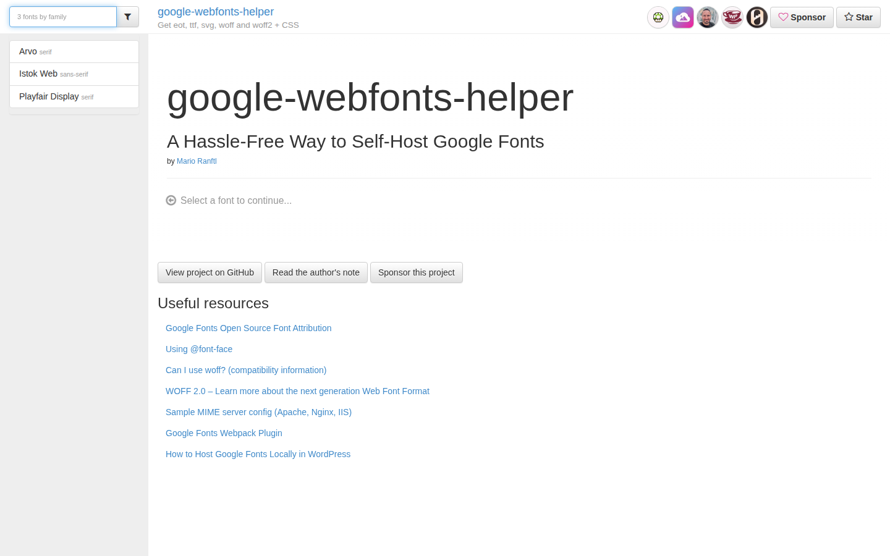
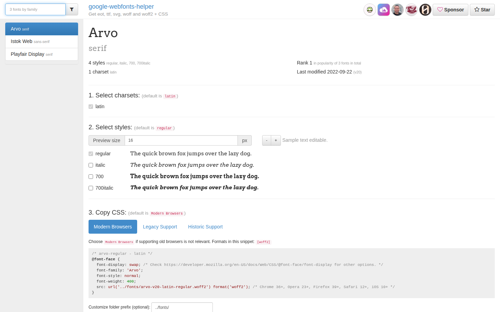

<!--
N.B.: This README was automatically generated by https://github.com/YunoHost/apps/tree/main/tools/readme_generator
It shall NOT be edited by hand.
-->

# Google Webfonts Helper for YunoHost

[](https://dash.yunohost.org/appci/app/google-webfonts-helper)  <br>
[](https://install-app.yunohost.org/?app=google-webfonts-helper)

*[Lire ce readme en français.](./README_fr.md)*

> *This package allows you to install Google Webfonts Helper quickly and simply on a YunoHost server.
If you don't have YunoHost, please consult [the guide](https://doc.yunohost.org/admin/get_started/install_on/) to learn how to install it.*

## Overview

A hassle-free way to self-host Google Fonts: browse the font directory, pick charsets and styles, copy the `@font-face` CSS snippets and download the font files (eot, ttf, svg, woff, woff2) as a zip archive.

**Shipped version:** 1.7.2~ynh1

**Demo:** https://gwfh.mranftl.com

## Screenshots




## Disclaimers / important information

* The app itself has no login: it is wrapped by the YunoHost portal only if you restrict its main permission to logged-in users.
* The font **list** is fetched from Google's Web Fonts Developer API, which requires a free API key. Without a key the app starts in **demo mode** and shows only 3 example fonts. Create a key at <https://console.cloud.google.com/apis/library/webfonts.googleapis.com> and paste it in the app's config panel, then it will restart with the full font list.
* Upstream hardcodes absolute URLs, so the app should be installed at the **root of a domain** (`/`). The package patches and serves the UI for a sub-path on a best-effort basis, but the root install is the supported one.
* Downloaded font files themselves come from Google's public font servers at request time: the app does not store a copy of the whole Google Fonts library.

## Documentation and resources

* Official app website: <https://gwfh.mranftl.com>
* Official admin documentation: <https://github.com/majodev/google-webfonts-helper#readme>
* Upstream app code repository: <https://github.com/majodev/google-webfonts-helper>
* YunoHost documentation for this app: <https://yunohost.org/app_google-webfonts-helper>
* Report a bug: <https://github.com/YunoHost-Apps/google-webfonts-helper_ynh/issues>

## Developer info

Please send your pull request to the [testing branch](https://github.com/YunoHost-Apps/google-webfonts-helper_ynh/tree/testing).

To try the testing branch, please proceed like that.

``` bash
sudo yunohost app install https://github.com/YunoHost-Apps/google-webfonts-helper_ynh/tree/testing --debug
or
sudo yunohost app upgrade google-webfonts-helper -u https://github.com/YunoHost-Apps/google-webfonts-helper_ynh/tree/testing --debug
```

**More info regarding app packaging:** <https://doc.yunohost.org/dev/packaging/>
