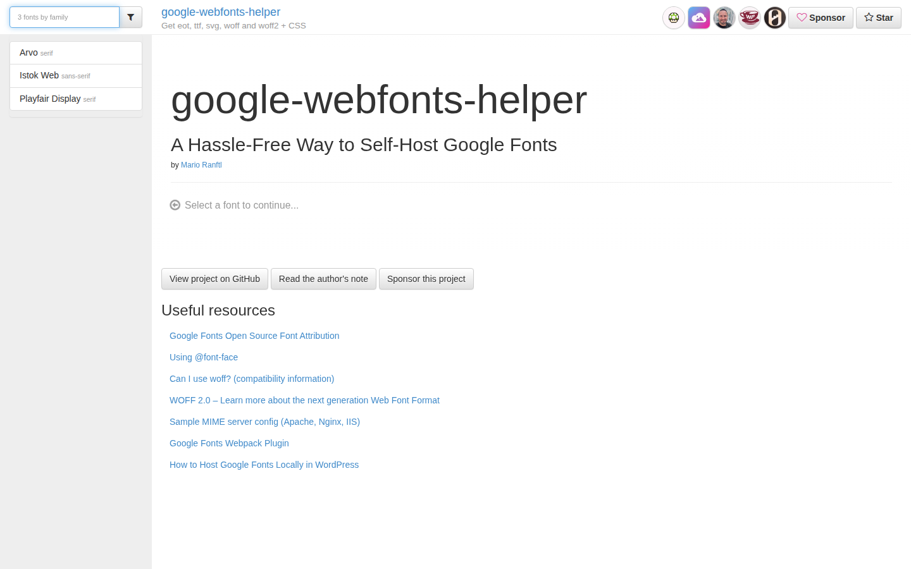
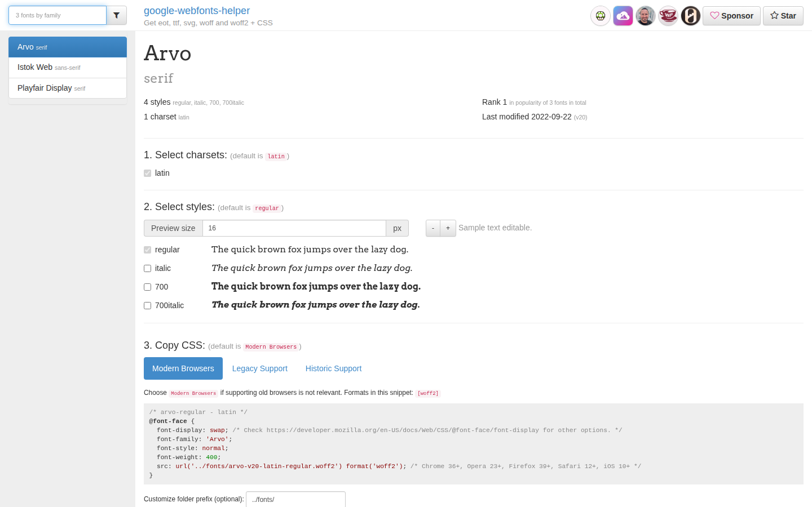

<!--
N.B.: This README a été généré automatiquement par https://github.com/YunoHost/apps/tree/main/tools/readme_generator
Il ne doit PAS être édité à la main.
-->

# Google Webfonts Helper pour YunoHost

[](https://dash.yunohost.org/appci/app/google-webfonts-helper)  
[](https://install-app.yunohost.org/?app=google-webfonts-helper)

*[Read this readme in english.](./README.md)*

> *Ce package vous permet d'installer Google Webfonts Helper rapidement et simplement sur un serveur YunoHost.
Si vous n'avez pas YunoHost, regardez [ici](https://doc.yunohost.org/admin/get_started/install_on/) pour savoir comment l'installer et en profiter.*

## Vue d'ensemble

Une méthode simple pour auto-héberger les Google Fonts : parcourir le catalogue de polices, choisir les jeux de caractères et les styles, copier les extraits CSS `@font-face` et télécharger les fichiers de polices (eot, ttf, svg, woff, woff2) en archive zip.

**Version incluse :** 1.7.2~ynh1

**Démo :** https://gwfh.mranftl.com

## Captures d'écran




## Avertissements / informations importantes

* L'application n'a pas de connexion propre : elle n'est protégée par le portail YunoHost que si vous restreignez sa permission principale aux utilisateurs connectés.
* La **liste** des polices est récupérée via l'API Google Web Fonts Developer, qui nécessite une clé d'API gratuite. Sans clé, l'application démarre en **mode démo** et n'affiche que 3 polices d'exemple. Créez une clé sur <https://console.cloud.google.com/apis/library/webfonts.googleapis.com> et collez-la dans le panneau de configuration de l'application, qui redémarrera alors avec la liste complète.
* L'amont code en dur des URL absolues, l'application doit donc être installée à la **racine d'un domaine** (`/`). Le package corrige et sert l'interface sous un sous-chemin dans la mesure du possible, mais l'installation à la racine est la seule prise en charge.
* Les fichiers de polices téléchargés proviennent des serveurs publics de Google au moment de la requête : l'application ne stocke pas une copie de toute la bibliothèque Google Fonts.

## Documentations et ressources

* Site officiel de l'app : <https://gwfh.mranftl.com>
* Documentation officielle de l'admin : <https://github.com/majodev/google-webfonts-helper#readme>
* Dépôt de code officiel de l'app : <https://github.com/majodev/google-webfonts-helper>
* Documentation YunoHost pour cette app : <https://yunohost.org/app_google-webfonts-helper>
* Signaler un bug : <https://github.com/YunoHost-Apps/google-webfonts-helper_ynh/issues>

## Informations pour les développeurs

Merci de faire vos pull request sur la [branche testing](https://github.com/YunoHost-Apps/google-webfonts-helper_ynh/tree/testing).

Pour essayer la branche testing, procédez comme suit.

``` bash
sudo yunohost app install https://github.com/YunoHost-Apps/google-webfonts-helper_ynh/tree/testing --debug
ou
sudo yunohost app upgrade google-webfonts-helper -u https://github.com/YunoHost-Apps/google-webfonts-helper_ynh/tree/testing --debug
```

**Plus d'infos sur le packaging d'applications :** <https://doc.yunohost.org/dev/packaging/>
